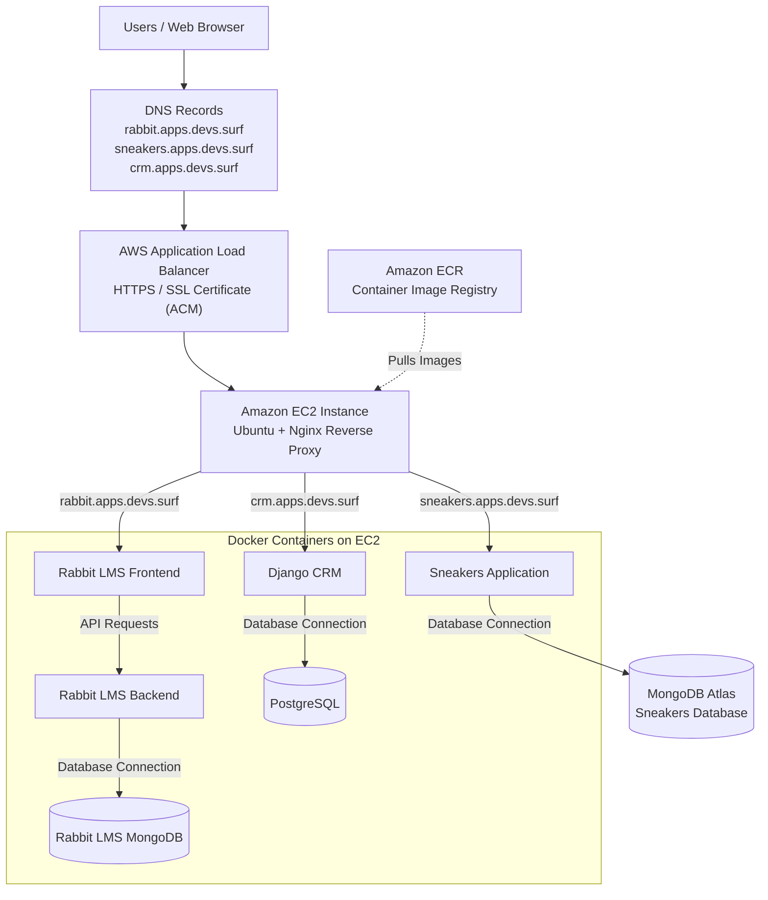

# AWS Multi-Application Hosting with Terraform and Docker

## Project Overview

This project demonstrates the design and deployment of a cost-efficient, multi-application hosting infrastructure on AWS using Terraform, Docker, Docker Compose and Nginx.

The primary objective was to solve a common infrastructure challenge: how to host and manage multiple independent applications without provisioning a separate cloud server for each application.

For applications primarily used for demonstrations, development, testing and other low-traffic purposes, deploying each application on a dedicated EC2 instance can result in unnecessary infrastructure costs and underutilised computing resources.

To address this, I designed a shared hosting environment where multiple applications run on a single EC2 instance while maintaining separate containers, application configurations, databases and access URLs.

The infrastructure provides a centralised hosting environment where applications can be deployed and accessed independently through their respective subdomains.

## Architecture Diagram

## The Problem I Wanted to Solve

Hosting multiple applications on separate EC2 instances can increase costs, especially when the applications are mainly used for testing, demonstrations and low-traffic purposes.

I wanted to find a way to:

- Host multiple applications on one EC2 instance.
- Reduce the cost of running separate servers.
- Keep each application's services and database separate.
- Access each application through its own domain.
- Manage the infrastructure using Terraform.
- Make it easier to add more applications to the same hosting environment.

## Applications Hosted

The infrastructure currently hosts three applications:

| Application | Description | Subdomain |
|---|---|---|
| Rabbit LMS | Learning Management System | `rabbit.apps.devs.surf` |
| Sneakers | E-commerce application | `sneakers.apps.devs.surf` |
| Django CRM | Customer Relationship Management | `crm.apps.devs.surf` |

Each application runs in its own containers with its supporting services.

## Architecture

The project uses a shared EC2 hosting architecture.

**How it works:**

1. A user visits an application's subdomain.
2. DNS directs the request to the AWS Application Load Balancer.
3. The ALB handles HTTPS using an SSL/TLS certificate from AWS Certificate Manager.
4. The ALB forwards the request to the EC2 instance.
5. Nginx checks the requested subdomain and routes traffic to the correct application.
6. The application processes the request and communicates with its database where required.
7. The response is returned to the user through Nginx and the ALB.

### Architecture Components

**1. AWS VPC and Networking**

Created a custom VPC with public and private subnets, an Internet Gateway and route tables to provide network connectivity.

Configured security groups to control access to the infrastructure.

**2. Terraform**

Used Terraform to provision the AWS infrastructure.

Organised the configuration into reusable modules to make resource management easier and keep the project organised.

Resources include:

- VPC and subnets
- Internet Gateway and route tables
- EC2 instance
- Security groups
- Application Load Balancer
- Target group and listeners
- SSL/TLS certificate integration

**3. Amazon EC2**

Deployed one EC2 instance to host all three applications.

The instance acts as the central hosting server for the Docker containers.

**4. Docker and Docker Compose**

Used Docker to containerise the applications and their supporting services.

Docker Compose manages the containers and their communication.

The services include:

- Rabbit LMS: Frontend, backend and MongoDB.
- Sneakers: Application container.
- Django CRM: Application and PostgreSQL database.

Each application has its own services and database. Database ports are kept within Docker networking and are not exposed publicly.

**5. Amazon ECR**

Used Amazon Elastic Container Registry to store the application Docker images.

The images are pushed to ECR and pulled by the EC2 instance during deployment.

An EC2 IAM role provides the permissions required to access the images.

**6. Nginx Reverse Proxy**

Configured Nginx on the EC2 instance to route incoming requests based on the requested subdomain.

| Subdomain | Destination |
|---|---|
| `rabbit.apps.devs.surf` | Rabbit frontend |
| `sneakers.apps.devs.surf` | Sneakers application |
| `crm.apps.devs.surf` | Django CRM |

Rabbit LMS also has a separate API route that forwards requests to its backend container.

This allows all three applications to share the same server and public entry point.

**7. AWS Application Load Balancer**

Configured an internet-facing Application Load Balancer to handle incoming traffic.

- HTTP listener on port 80 redirects traffic to HTTPS.
- HTTPS listener on port 443 handles secure requests.
- A target group forwards traffic to the EC2 instance on port 80.
- Health checks monitor the EC2 target.

**8. AWS Certificate Manager**

Used AWS Certificate Manager to manage the SSL/TLS certificate for the application subdomains.

This allows users to access the applications securely over HTTPS without managing separate certificates inside each container.

**9. DNS Configuration**

Configured the application subdomains to point to the Application Load Balancer.

This allows each application to be accessed using its own URL while sharing the same infrastructure.

## Security Configuration

Implemented the following security measures:

- Restricted SSH access to an authorised IP address.
- Allowed EC2 application traffic only from the ALB security group.
- Used security groups to control network access.
- Enabled HTTPS through the Application Load Balancer.
- Kept database ports private within Docker networking.
- Used an EC2 IAM role to retrieve images from Amazon ECR.

## Technologies Used

| Category | Tools |
|---|---|
| Cloud Platform | AWS |
| Infrastructure as Code | Terraform |
| Compute | Amazon EC2 |
| Containerisation | Docker |
| Container Management | Docker Compose |
| Reverse Proxy | Nginx |
| Load Balancer | AWS Application Load Balancer |
| Container Registry | Amazon ECR |
| SSL/TLS | AWS Certificate Manager |
| Networking | VPC, Subnets, Internet Gateway, Route Tables, Security Groups |
| Databases | MongoDB, PostgreSQL |

## Key Learnings

Through this project, I gained practical experience in:

- Building AWS infrastructure with Terraform modules.
- Hosting multiple applications on one EC2 instance.
- Managing multiple containers and databases with Docker Compose.
- Configuring Nginx for subdomain-based routing.
- Connecting DNS, HTTPS, load balancers and reverse proxies.
- Managing Docker images with Amazon ECR.
- Configuring IAM permissions and AWS security groups.
- Troubleshooting application and infrastructure issues.

## Design Considerations

This architecture is designed for cost efficiency and low-traffic applications.

Hosting multiple applications on one EC2 instance reduces the number of servers required, but it also means they share the same computing resources.

The EC2 instance is a single point of failure, so this design is not intended for applications that require high availability or independent scaling.

## Conclusion

The goal of this project was to build a shared hosting environment that reduces infrastructure costs while keeping multiple applications organised and accessible.

By combining Terraform, AWS, Docker Compose and Nginx, I was able to provision the infrastructure, deploy three applications and route traffic to each one through its own subdomain.

**The main idea: Host more applications with fewer servers and make better use of available cloud resources.**
